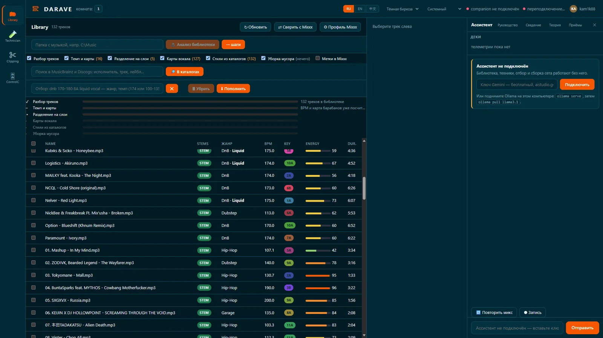
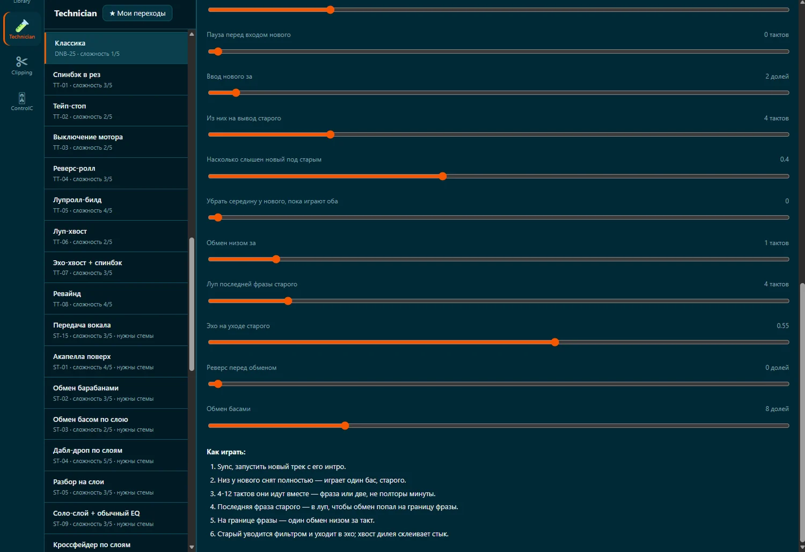
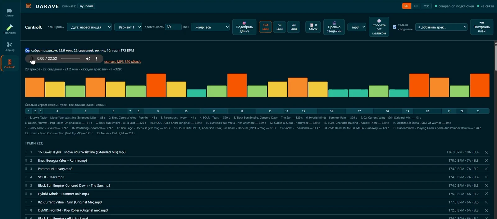
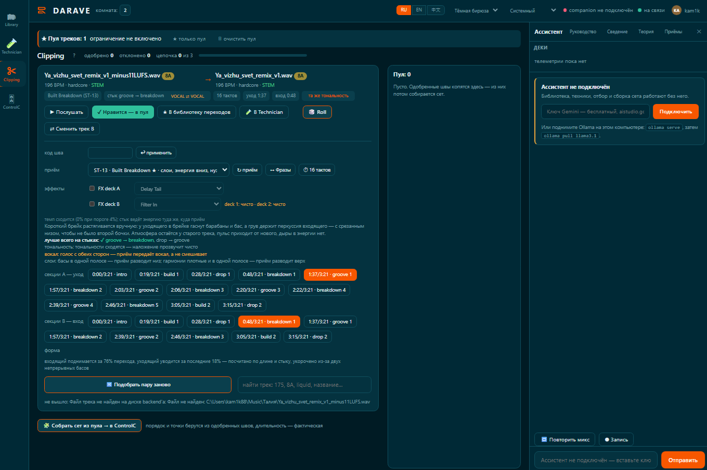

# DARAVE

[English](README.md) · [Русский](README.ru.md)


**Digital Audio Rave — A DJ mixing tool that analyzes your music, finds transitions, and renders the mix.**


[Website](https://darave.ru/) · [Download for Windows](https://darave.ru/) · [Releases](https://github.com/kam1k88/darave-releases) 


DARAVE is a Windows application for analyzing music libraries, discovering DJ transitions, and assembling complete mixes.

It does more than match tracks by BPM and key. DARAVE analyzes musical structure, estimates transition points, selects mixing techniques, and lets you audition every proposed transition before approving it.

**You make the musical decisions. DARAVE handles the analysis and audio processing.**

## How it works

The workflow consists of four stages:

```text
┌─────────────────────┐
│  1. MUSIC LIBRARY   │
│                     │
│  Scan and analyze   │
│  local audio files  │
└──────────┬──────────┘
           │
           ▼
┌─────────────────────┐
│  2. TRANSITION      │
│     SELECTION       │
│                     │
│  Track pair         │
│  Technique          │
│  Entry / exit points│
└──────────┬──────────┘
           │
           ▼
┌─────────────────────┐
│  3. AUDITION &      │
│     APPROVAL        │
│                     │
│  Listen, evaluate,  │
│  accept or reject   │
└──────────┬──────────┘
           │
           ▼
┌─────────────────────┐
│  4. MIX ASSEMBLY    │
│                     │
│  Arrange approved   │
│  transitions and    │
│  render the set     │
└─────────────────────┘
```

A transition is represented by more than a pair of tracks. It includes the selected technique, musical entry and exit points, timing, and mixing parameters.

Rejected transitions provide feedback that helps refine subsequent suggestions.

## Music library analysis

DARAVE builds its own musical representation of the local library.

The analysis pipeline covers:

| Parameter | Purpose |
|---|---|
| BPM | Tempo estimation and alignment |
| Key | Harmonic compatibility and Camelot notation |
| Energy | Energy progression across a set |
| Musical structure | Phrase boundaries and transition points |
| Genre and style | Style-aware technique selection |
| Vocals | Vocal-aware transition selection |
| Stems | Analysis and processing of individual musical layers |
| Duration and loudness | Timing and level consistency |

The application analyzes files locally. Music does not need to be uploaded to a cloud service.

Analysis is incremental: files that have not changed do not need to be processed again.

## Transition selection

DARAVE contains **63 DJ transition techniques**.

The selection process considers the musical context of both tracks instead of applying one universal transition pattern.

Examples include:

- Harmonic blends
- Bass swaps
- Long blends
- Filter sweeps
- Quick cuts
- Phrase-based transitions
- Drop synchronization
- Vocal transitions
- Stem-based transitions
- FX transitions

The technique catalog describes the steps and parameters required to perform each transition.

### Musical context matters

A transition is evaluated through several interacting factors:

- Tempo relationship, including half-time and double-time interpretations
- Harmonic compatibility
- Phrase alignment
- Drum and bass activity
- Energy difference
- Genre and subgenre
- Vocal and stem availability

Genre profiles influence technique selection and transition duration. The same technique is not necessarily appropriate for house, techno, drum & bass, or big-room material.

## Transition audition and correction

DARAVE does not treat an automatically generated transition as a final decision.

Each proposed seam can be auditioned before approval.

The user can:

1. Listen to the proposed transition.
2. Evaluate the technique and its musical result.
3. Accept or reject the suggestion.
4. Refine a problematic transition.
5. Return the corrected result to the set plan.

The application highlights problematic transitions and allows them to be corrected without rebuilding the entire set manually.

## Set assembly and export

Approved transitions are assembled into a continuous DJ mix.

Set planning can account for:

- Track order and compatibility
- Energy progression
- Target set duration
- Transition length
- Entry and exit points
- Mixing parameters

The finished set can be exported as:

- FLAC
- WAV
- MP3

The application also provides a playlist and a transition breakdown to help understand how the set was assembled.

## Local-first architecture

DARAVE is designed to run on the user's Windows computer.

```text
           LOCAL MUSIC LIBRARY
                    │
                    ▼
             TRACK ANALYSIS
                    │
                    ▼
          MUSICAL REPRESENTATION
                    │
                    ▼
           TRANSITION ENGINE
                    │
             ┌──────┴──────┐
             │             │
             ▼             ▼
       TECHNIQUE       MIX PARAMETERS
        SELECTION       ESTIMATION
             │             │
             └──────┬──────┘
                    │
                    ▼
             TRANSITION PREVIEW
                    │
                    ▼
              USER APPROVAL
                    │
                    ▼
               MIX RENDERER
                    │
                    ▼
                AUDIO FILE
```

Core analysis, transition processing, and rendering take place locally.

Internet access is only needed for optional enrichment of track styles from external music catalogs. The core workflow does not require uploading a music library.

## What DARAVE is not

DARAVE is not an autonomous AI DJ, a music generator, or a replacement for a DJ.

It does not independently decide what to play at a live event.

Its purpose is to reduce the amount of manual searching and technical trial and error required to build a mix. The user listens to the proposed transitions and decides which ones belong in the final set.

Automatic analysis is an estimate, not a guarantee of musical compatibility. Results can vary depending on genre, production style, and recording quality.

## Installation

DARAVE is distributed as a Windows installer.

- Windows 10 / 11, 64-bit
- Approximately 450 MB of disk space
- 8 GB RAM for the core application
- 16 GB RAM recommended for stem processing
- NVIDIA GPU optional; it can accelerate stem separation

No Python installation or administrator privileges are required.

Stem separation is an optional additional package of approximately 3 GB.

[Download DARAVE](https://darave.ru/)

## Project status

DARAVE is an independently developed software product.

The current release provides a complete workflow for:

- Local music library analysis
- Transition discovery
- Selection from a catalog of 63 techniques
- Transition audition and approval
- Set planning
- Audio rendering and export

The product is actively developed. Its scope is deliberately focused on transition quality and reliable mix assembly rather than autonomous live performance.

## Screenshots

### Music library



### Transition selection



### Set control



### Transition parameter selection



## Links

- [Official website](https://darave.ru/)
- [Download](https://darave.ru/)
- [Release repository](https://github.com/kam1k88/darave-releases)
- [Developer profile](https://github.com/kam1k88)
