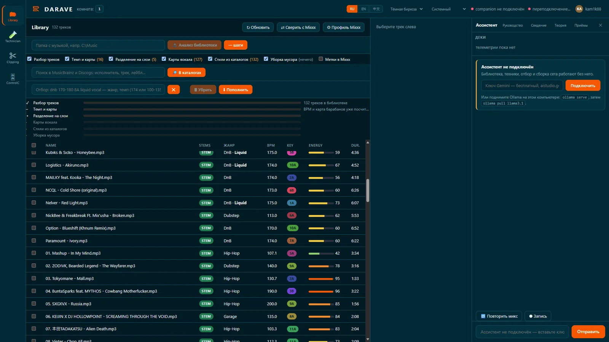
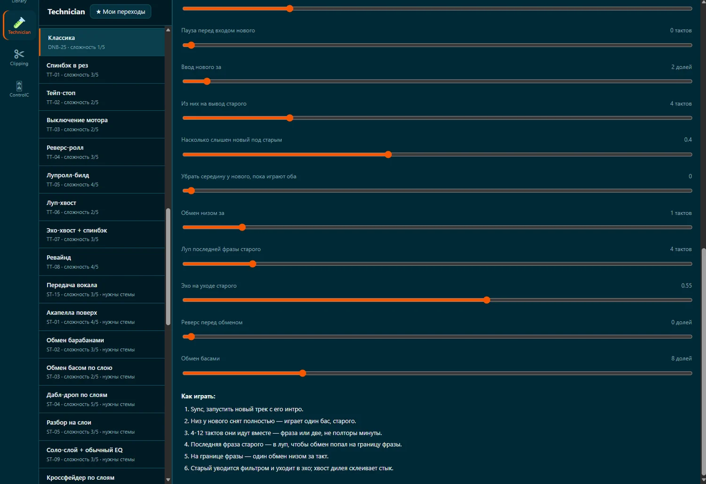
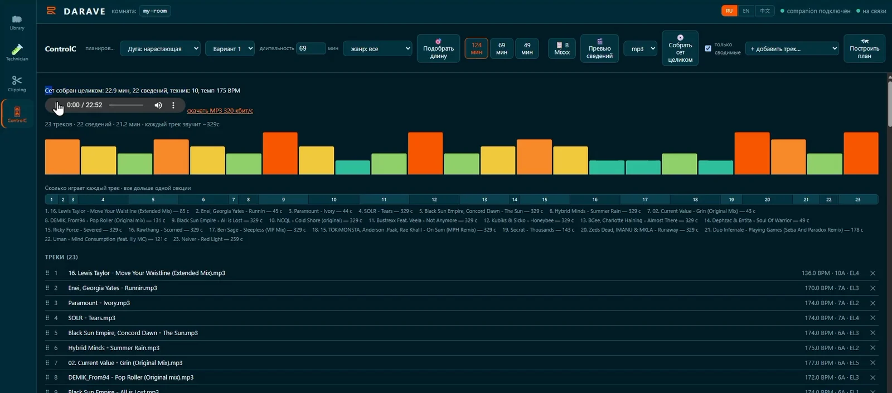
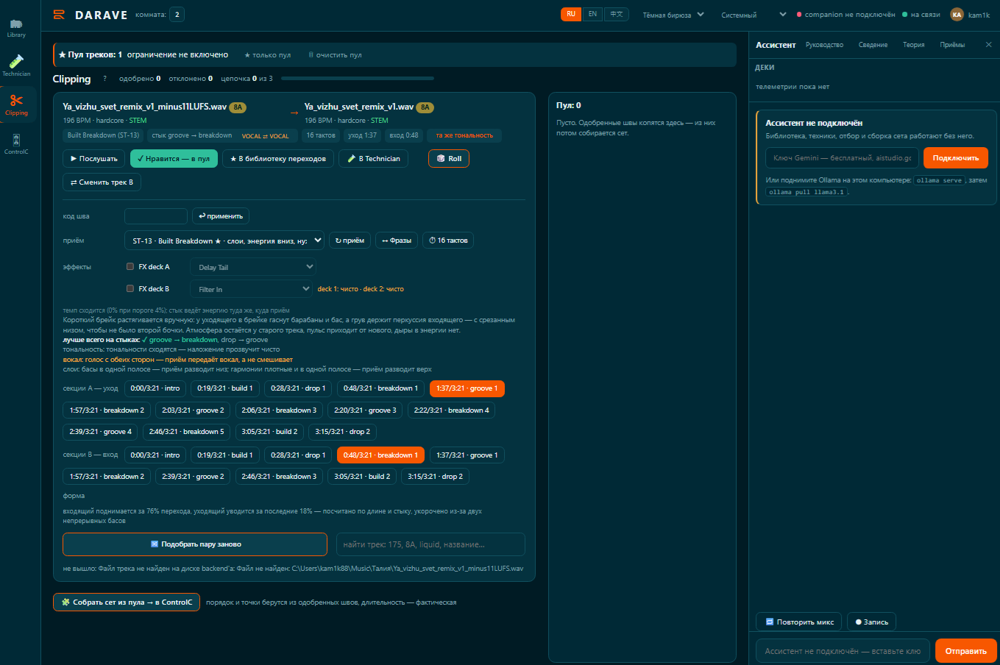

# DARAVE


**Digital Audio Rave — программа для DJ-микширования, которая анализирует музыку, находит варианты переходов и собирает готовые миксы.**

[English](README.md) · [Сайт](https://darave.ru/) · [Скачать для Windows](https://darave.ru/) · [Релизы](https://github.com/kam1k88/darave-releases)

DARAVE — приложение для Windows, предназначенное для анализа музыкальной библиотеки, поиска DJ-переходов и сборки полноценных миксов.

Программа не ограничивается сопоставлением треков по BPM и тональности. Она анализирует музыкальную структуру, определяет возможные точки перехода, подбирает технику сведения и позволяет прослушать каждый предложенный переход до подтверждения.

**Музыкальные решения остаются за вами. DARAVE берёт на себя анализ и обработку звука.**

## Как это работает

Рабочий процесс состоит из четырёх этапов:

```text
┌─────────────────────┐
│  1. МУЗЫКАЛЬНАЯ     │
│     БИБЛИОТЕКА      │
│  Сканирование и     │
│  анализ аудиофайлов │
└──────────┬──────────┘
           ▼
┌─────────────────────┐
│  2. ПОДБОР          │
│     ПЕРЕХОДА        │
│  Пара треков        │
│  Техника сведения   │
│  Точки входа/выхода │
└──────────┬──────────┘
           ▼
┌─────────────────────┐
│  3. ПРОСЛУШИВАНИЕ И  │
│     ПОДТВЕРЖДЕНИЕ   │
│  Оценка, принятие   │
│  или отклонение     │
└──────────┬──────────┘
           ▼
┌─────────────────────┐
│  4. СБОРКА МИКСА    │
│  Компоновка         │
│  подтверждённых     │
│  переходов и рендер │
└─────────────────────┘
```

Переход — это не просто пара треков. Он включает выбранную технику сведения, музыкальные точки входа и выхода, тайминг и параметры микширования. Отклонённые переходы учитываются при последующем подборе вариантов.

## Анализ музыкальной библиотеки

DARAVE формирует музыкальное представление локальной библиотеки. В анализ входят:

| Параметр | Назначение |
|---|---|
| BPM | Определение и сопоставление темпа |
| Тональность | Гармоническая совместимость и нотация Camelot |
| Энергия | Контроль динамики сета |
| Музыкальная структура | Границы фраз и точки перехода |
| Жанр и стиль | Подбор техники с учётом музыкального стиля |
| Вокал | Выбор переходов с учётом вокальных партий |
| Стемы | Анализ и обработка отдельных музыкальных слоёв |
| Длительность и громкость | Согласование тайминга и уровней |

Приложение анализирует файлы локально. Загружать музыку в облачный сервис не требуется. Анализ выполняется инкрементально: если файл не изменился, повторно обрабатывать его не нужно.

## Подбор переходов

В DARAVE предусмотрено **63 техники DJ-сведения**. При выборе учитывается музыкальный контекст обоих треков, а не применяется один универсальный шаблон.

Примеры техник:

- Гармоническое сведение и замена баса
- Длинные переходы и быстрые склейки
- Переходы по музыкальным фразам
- Синхронизация дропов
- Переходы с учётом вокала
- Переходы на основе стемов и эффектов

При оценке перехода учитываются соотношение темпов (включая half-time и double-time), гармоническая совместимость, совпадение музыкальных фраз, активность ударных и баса, разница в энергетике, жанр и наличие вокала. Жанровые профили влияют на выбор техники и длительность перехода.

## Прослушивание и корректировка

DARAVE не считает автоматически предложенный переход окончательным решением. Каждый стык можно прослушать до подтверждения.

Пользователь может:

1. Прослушать предложенный переход.
2. Оценить выбранную технику и результат сведения.
3. Принять или отклонить предложение.
4. Исправить проблемный переход.
5. Вернуть скорректированный результат в план сета.

Проблемные переходы можно исправлять, не пересобирая весь сет вручную.

## Сборка сета и экспорт

Подтверждённые переходы объединяются в непрерывный DJ-микс. При планировании могут учитываться порядок и совместимость треков, развитие энергетики, целевая продолжительность сета, длительность переходов, точки входа и выхода и параметры микширования.

Готовый сет можно экспортировать в **FLAC, WAV или MP3**. Приложение также формирует плейлист и описание переходов.

## Локальная архитектура

DARAVE рассчитана на работу на компьютере пользователя под Windows.

```text
ЛОКАЛЬНАЯ МУЗЫКАЛЬНАЯ БИБЛИОТЕКА
                 │
                 ▼
             АНАЛИЗ ТРЕКОВ
                 │
                 ▼
       МУЗЫКАЛЬНОЕ ПРЕДСТАВЛЕНИЕ
                 │
                 ▼
          МОДУЛЬ ПЕРЕХОДОВ
                 │
          ┌──────┴──────┐
          ▼             ▼
      ВЫБОР ТЕХНИКИ   ОЦЕНКА ПАРАМЕТРОВ
       СВЕДЕНИЯ        МИКШИРОВАНИЯ
          └──────┬──────┘
                 ▼
        ПРЕДПРОСЛУШИВАНИЕ
             ПЕРЕХОДА
                 │
                 ▼
         ПОДТВЕРЖДЕНИЕ
          ПОЛЬЗОВАТЕЛЕМ
                 │
                 ▼
           РЕНДЕР МИКСА
                 │
                 ▼
             АУДИОФАЙЛ
```

Основные этапы анализа, обработки переходов и рендеринга выполняются локально. Подключение к интернету требуется только для дополнительного обогащения информации о стилях треков из внешних музыкальных каталогов. Для основного рабочего процесса загружать музыкальную библиотеку в облако не требуется.

## Чем DARAVE не является

DARAVE — не автономный AI-диджей, не генератор музыки и не замена диджею. Программа самостоятельно не решает, какую музыку ставить на живом выступлении.

Её задача — сократить время на поиск подходящих сочетаний треков и технические эксперименты при подготовке микса. Пользователь прослушивает предложенные переходы и сам решает, какие из них войдут в итоговый сет.

Автоматический анализ даёт оценку, а не гарантию музыкальной совместимости. Результат зависит от жанра, особенностей продакшена и качества записи.

## Установка

DARAVE распространяется в виде установщика для Windows.

- Windows 10 / 11, 64-разрядная версия
- Около 450 МБ свободного места на диске
- 8 ГБ оперативной памяти для основной версии
- 16 ГБ оперативной памяти рекомендуется для обработки стемов
- Видеокарта NVIDIA не обязательна, но может ускорить разделение стемов

Устанавливать Python, Mixxx или запускать приложение с правами администратора не требуется. Разделение стемов доступно как дополнительный пакет объёмом около 3 ГБ.

[Скачать DARAVE](https://darave.ru/)

## Состояние проекта

DARAVE — самостоятельно разработанный программный продукт. Текущая версия предоставляет полный рабочий процесс:

- Анализ локальной музыкальной библиотеки
- Поиск вариантов переходов
- Выбор из каталога 63 техник сведения
- Прослушивание и подтверждение переходов
- Планирование сета
- Рендеринг и экспорт аудио

Разработка продолжается. Основной фокус продукта — качество переходов и надёжная сборка микса, а не автономное управление живым выступлением.

## Скриншоты

### Музыкальная библиотека



### Подбор перехода



### Управление сетом



### Подбор параметров перехода



## Ссылки

- [Официальный сайт](https://darave.ru/)
- [Скачать программу](https://darave.ru/)
- [Репозиторий релизов](https://github.com/kam1k88/darave-releases)
- [Профиль разработчика](https://github.com/kam1k88)
